  <!-- BANNER SVG CARREGADO COMO IMAGEM -->
  

    

---
  <!-- REDES SOCIAIS COM BOTÕES CLICÁVEIS -->
  

    
    
    
    
  

# Gustavo Gianeli Rodrigues
### **By: 𝕿𝖍𝖊 𝑺𝖊𝖛𝖊𝖓𝖙𝖍**

**Estudante de Ciência da Computação | Entusiasta de Linux & Arch User | he/him**

Sou estudante do 2º ano de Ciência da Computação, movido pela curiosidade de entender como as coisas funcionam por baixo dos panos. Sou *"hands-on"* por natureza, com um foco enorme em **automação, Infraestrutura e ferramentas de pentest**. 

No momento estou procurando estágio na area de TI, também estou focando nos meus estudos de Inglês (nível básico) e estudos por fora como o Alura para expandir meus conhecimentos e minhas oportunidades na área tech.

## 🛠️ Tecnologias e Ferramentas

  
  
  
  
   
  
  
  
  

---

## 🚀 Projetos Pessoais & Open Source
*Aplicações e scripts que criei do zero para resolver problemas reais, otimizar sistemas e construir minha própria infraestrutura.*

* 🐧 **[post-install-arch-full](https://github.com/GustavoGianeli/post-install-arch-full)**
  >Uma ferramenta modular de pós-instalação e provisionamento para Arch Linux e sistemas compatíveis, com detecção de ambiente, configuração automatizada e perfis especializados.
* 🐧 **[arch-update-full](https://github.com/GustavoGianeli/arch-update-full)**
  > Meu próprio script publicado oficialmente no **AUR** (Arch User Repository). Desenvolvido para automatizar e realizar a atualização completa de sistemas baseados em Arch Linux com segurança.
* 🖥️ **[my-home-server-alicerce](https://github.com/GustavoGianeli/my-home-server-alicerce)**
  > Um projeto base e estrutural projetado para ser o alicerce na configuração e subida de servidores caseiros (*homelabs*).

---

## 📚 Estudos & Projetos Modificados
*Projetos desenvolvidos durante a faculdade e cursos (como Alura). Não são apenas cópias das aulas: refatorei a lógica, adicionei novas funcionalidades (como banco de dados) e apliquei minha própria visão arquitetural.*

* 🍕 **[Sabor Express - CLI & SQLite](https://github.com/GustavoGianeli/Alura-Python-Sabor-express)** — Aplicação de terminal completamente refatorada com persistência de dados real, buscas parciais e interface estilizada.
* 🎟️ **[Projeto: Ingresso para Show](https://github.com/GustavoGianeli/Alura-Projeto-ingresso-para-show-)** — Lógica de sistema de compras e controle de disponibilidade.
* 🎮 **[Projeto: Alugando Games](https://github.com/GustavoGianeli/Alura-projeto-alugando-games-)** — Sistema estruturado para gestão e aluguel de jogos.
* 🎲 **[Sorteador de Números](https://github.com/GustavoGianeli/SorteadorDeNumeros-alura)** — Aplicação prática envolvendo lógica matemática e geração de dados.
* 🕵️ **[Jogo: Número Secreto](https://github.com/GustavoGianeli/Alura-Jogo-numero-secreto)** — Projeto clássico de adivinhação para solidificação de conceitos básicos.

---

📫 **Como me encontrar:**
- GitHub: [@GustavoGianeli](https://github.com/GustavoGianeli)
- Nickname: **𝕿𝖍𝖊 𝑺𝖊𝖛𝖊𝖓𝖙𝖍***
- Email: **gustavo.gianeli13@gmail.com**
- Linkedin: www.linkedin.com/in/gustavo-gianeli
- Instagram: https://www.instagram.com/gustavo.gianeli.setimo/

---
